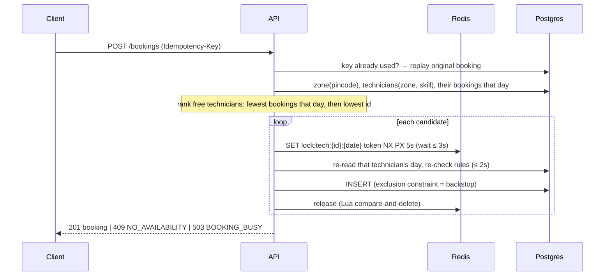

# Design notes

## How this was built: spec-driven development

1. **Grilling the requirements.** I took the brief, including the nice-to-haves, and stress-tested it with my AI agent using a *grilling* skill. The agent asked questions in rounds, each with a recommended answer, and I made every decision.
   - Over about 40 questions we settled the ambiguous rules: buffer and shift edges, the booking window, tie-breaks, cancellation and idempotency semantics.
   - We also settled the design: Go + Gin, Postgres, a Redis lock as the primary mechanism with the DB constraint as backstop, the schema and id conventions, the error model, the project layout and the test seams.
   - We stopped only when nothing was left silently assumed: a shared understanding of the whole system.
2. **Writing the spec.** I generated a specification from that conversation with a *to-spec* skill: [docs/specs/doorstep-service-booking.md](docs/specs/doorstep-service-booking.md). It holds the user stories, implementation decisions, testing decisions and what is out of scope.
3. **Implementing against the spec.** The agent implemented the system that follow the spec (schema → seed → pure rules → repositories → lock → services → HTTP → integration tests → extras). Each step came with its tests.
4. **Review and testing.** I reviewed every change before it was committed and ran the tests and the stack myself, requesting changes along the way.

## How a booking is made

## 1. Concurrency choice

**How double-booking is prevented**
- **Primary: a Redis lock per technician per day.** Only requests for the *same* technician on the *same* day wait for each other. Everything else runs in parallel.
  - It's per day rather than per slot because a 10:00 job and a 10:30 job are different slots but overlap.
  - Days never interact, because the latest a technician is busy is 20:30.
- **Re-check under the lock.** The technician's day is re-read and the pure rules (`CanTake`) re-applied. If the technician was taken meanwhile, the loop moves on to the next-ranked one.
- **Backstop: a Postgres exclusion constraint** on `(technician_pk, tstzrange(start, end + 30m))` for non-cancelled rows. Even if the lock fails, the database refuses an overlap. The app treats that as "taken, try the next technician".
- **Idempotency:** a unique `idempotency_key` column plus a request hash. The guarantee comes from the same INSERT, so it's never split across two systems.

**Why this over the alternatives**

| Option | Verdict |
|--------|---------|
| `SELECT … FOR UPDATE` on the technician row | Correct and simple for one database. But it holds a DB transaction and connection while the rules run, and it ties locking to the database. We wanted locking to survive a DB change. |
| Optimistic versioning | Needs one row to version. A conflict here is between *time ranges*, so we'd have to invent a technician-day row. Under a Monday spike, losers retry in a loop. |
| Unique constraint | `(technician, start_time)` only catches identical starts, not overlaps or buffers. Making it work means one row per 30-min cell, written for every booking. |
| Distributed lock (**chosen**) | Doesn't depend on the database, contention is scoped to a technician-day, and the DB transaction stays short. Its known weakness (below) is covered by the exclusion constraint, which is the range-aware version of the unique-constraint idea. |

**Where it breaks**
- **Lock expires mid-write** (GC pause, slow network): two requests can each think they hold it. The exclusion constraint rejects the second. DB work under the lock has a 2s timeout against the 5s TTL to make this rare.
- **Redis failover** loses a lock, because replication is asynchronous. Same outcome: the backstop catches it.
- **Redis down:** `POST /bookings` fails closed with `503`. Reads and cancel keep working.
- **Hot technician-day:** requests for it queue behind each other. After 3s the caller gets `503 BOOKING_BUSY`; retrying with the same key is safe.
- **Fairness:** "fewest bookings that day" is best-effort under races.
- **Leaving Postgres:** a database without exclusion constraints loses the backstop. The lock still works, but we'd need an equivalent, such as slot-cell unique keys.

## 2. Scale: 50 cities, 5,000 technicians, 200k bookings/day, 10x on Monday mornings

**Rough numbers**
- 200k/day is about 2.3 writes/s on average. Concentrated into business hours and multiplied by 10, that's about **70 bookings/s at peak**.
- Each booking is a few indexed reads plus one insert, so writes are not the problem.
- **Reads dominate.** Customers check availability many times per booking, so expect around **1–3k rps** on `GET /availability` at peak.

**What changes first**
1. **Availability is computed on every request** (zone → technicians → their day's bookings → 48 slots × technicians). This is the first thing to cache or precompute; see §3.
2. **Database connections.** API replicas are already stateless (locks and rate limits live in Redis), so we can scale out. But the replicas together will exhaust Postgres connections, so add PgBouncer and size `pgxpool`.
3. **Redis becomes critical** for bookings. Move to Sentinel or a managed HA setup.
4. **Then:**
   - Read replicas for the schedule and list endpoints, keeping read-after-write on the primary.
   - Partition `bookings` by month and archive old partitions.
   - A GIN index on `skills`.
   - Keyset pagination.
   - Eventually shard by city. Zones, locks and bookings are already city-local, so this splits cleanly.

**What I'd measure to know it's needed**
- p95/p99 latency per endpoint.
- Availability QPS and DB time per call.
- Lock wait time (histogram) and the `BOOKING_BUSY` rate.
- The rate of `409 NO_AVAILABILITY` *right after* a slot was shown, i.e. how often we show stale slots.
- Postgres: pool wait and saturation, CPU, slow queries.
- Redis: latency and errors.
- The `429` rate.

## 3. Keeping `GET /availability` fast without showing slots that are gone

- **Correctness never depends on the read path.** POST re-checks under the lock and behind the constraint, so a stale slot costs a `409` and a refresh, never a double booking. That lets us cache aggressively.
- **Step 1: cache the response** in Redis per `(zone, service, date)` with a short TTL (30–60s). **Invalidate on write:** after a booking or cancel commits, delete the keys for that zone and date. Showing a gone slot then needs a write that landed in the last few milliseconds.
- **Step 2: per-technician free bitmaps.** Keep 48 bits per technician per day in Redis, updated on every write and rebuildable from Postgres.
  - Availability becomes OR-ing the bitmaps of the zone's qualified technicians, plus a "duration fits" mask.
  - That's microseconds, with no database involved.
- **Also:**
  - Precompute the next 7 days off-peak.
  - Short `Cache-Control` or ETags so clients and CDNs absorb repeated polling.
  - Track the stale-slot `409` rate to tune the TTL.

## 4. Notifications without slowing or failing the booking API

- **Transactional outbox.**
  - Write a `booking_confirmed` row to an `outbox` table in the **same transaction** as the booking. Today the INSERT is a single statement, so it becomes a CTE or a small transaction.
  - The booking API never calls a provider: no extra latency, and the provider's outages can't affect bookings.
- **Relay.** A worker reads the outbox (`FOR UPDATE SKIP LOCKED`, or CDC with Debezium) and publishes to a queue (SQS, Kafka or RabbitMQ).
- **Consumers, one per channel:**
  - WhatsApp/SMS for the customer, push for the technician.
  - Retries use exponential backoff with jitter; failures that exhaust retries go to a dead-letter queue.
  - A circuit breaker sits on the SMS provider, with a fallback provider or channel (WhatsApp → SMS).
- **Delivery is at least once**, so sends are idempotent, keyed by `(booking_id, event, channel)`.
- **When the provider is down**, messages pile up and drain once it recovers. Alert on queue age, not just errors.

## 5. Reassigning jobs when a technician calls in sick

**What makes it easy**
- Assignment is one column, `technician_pk`.
- The rules (`CanTake`, `RankCandidates`) are pure functions, so "find the best replacement, excluding Ravi" reuses them as-is.
- The same lock-and-retry loop (`tryBook`) can perform the move.
- The exclusion constraint also guards an `UPDATE` of `technician_pk`, so a reassignment can never create an overlap.

**What makes it hard or missing**
- **No absence model.** Shifts are static, so a `technician_absences(technician, from, to)` table is needed. `CanTake` and availability must both respect it; otherwise sick technicians keep receiving new bookings.
- **Locking several technician-days at once:** acquire locks in sorted key order to avoid deadlock.
- **Partial failure:** some jobs on a busy day won't fit anywhere. We need a policy: an ops queue, offering the customer a reschedule, or cancelling with a notification.
- **Notifications** for the customer and both technicians, which depends on the outbox from §4.
- **An audit trail** (`booking_assignments` history), plus an idempotent ops action so a retried "reassign Ravi's day" doesn't move jobs twice.

## 6. With another week

Ordered by risk to the business:
1. **Outbox + notifications.** Customers currently get no confirmation, and it's the next feature the business needs.
2. **Technician absence + a reassignment endpoint.** Sick days are routine. Without this, ops edits data by hand.
3. **Observability.**
   - Prometheus metrics: lock wait, 409/503/429 rates, availability latency.
   - OpenTelemetry traces through API → Redis → Postgres.
   - Alerts on the signals from §2.
4. **Load test the Monday spike** (k6) to find the real first bottleneck, then build the availability cache or bitmaps from §3.
5. **Hardening:**
   - Customer auth (OTP) and an ownership check on cancel. Today anyone with a booking id can cancel.
   - Redis HA.
   - Keyset pagination.
